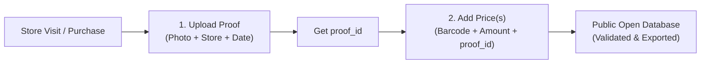

# Tutorial: How to Add Prices Using the Open Prices API

This step-by-step tutorial guides developers and community reusers on how to contribute prices to Open Prices using the REST API.

> ℹ️ If you have any questions or need API credentials, feel free to ask on the [Open Food Facts Slack](https://openfoodfacts.slack.com) in the **#prices** channel!

---

## Overview: The Proof-First Architecture

Open Prices is an evidence-backed open database. Unlike traditional price scrapers, **every price in the system must be linked to a proof** (a photograph of a physical store receipt or a shelf price tag).

The typical workflow consists of two main steps:

1. **Upload a Proof** (`POST /api/v1/proofs/upload`): Send the image along with store and date context. You will receive a `proof_id`.
2. **Add Price(s)** (`POST /api/v1/prices`): Send product barcodes and price values linked to that `proof_id`.



---

## Environments & Authentication

### 1. Environments

We offer two environments:

| Environment | Purpose | API Base URL / Swagger |
| :--- | :--- | :--- |
| **Pre-production** | Testing, development, and script validation | `https://prices.openfoodfacts.net/api/v1` ([Docs](https://prices.openfoodfacts.net/api/docs)) |
| **Production** | Live community data | `https://prices.openfoodfacts.org/api/v1` ([Docs](https://prices.openfoodfacts.org/api/docs)) |

> ⚠️ **Always test your integration on pre-production first** before pushing data to production.

### 2. User Accounts & Token Generation

* **Account Type**: Open Prices uses Open Food Facts user accounts. If you are developing an external app, bot, or reuser tool, we strongly recommend creating a **dedicated account specifically for your application** on [world.openfoodfacts.org](https://world.openfoodfacts.org).
* **Generating a Token**: Open Prices issues a session/bearer token:

```bash
curl -X POST "https://prices.openfoodfacts.net/api/v1/auth/token" \
  -H "Content-Type: application/json" \
  -d '{
    "username": "your_app_username",
    "password": "your_secret_password"
  }'
```

The response returns an access token:

```json
{
  "access_token": "eyJhbGciOi...",
  "token_type": "bearer"
}
```

* **Using the Token**: Include the token in the `Authorization` header for all subsequent write requests:
  ```http
  Authorization: Bearer <access_token>
  ```

---

## Step 1: Store Location and OpenStreetMap (OSM)

Open Prices relies on [OpenStreetMap (OSM)](https://www.openstreetmap.org) as its single source of truth for physical store locations (supermarkets, grocery stores, bakeries, etc.).

* You **do not need to create location records manually** before submitting a proof.
* When uploading a proof or creating a price, simply provide the store's OpenStreetMap identifiers:
  * `location_osm_id`: The numeric OSM ID (e.g., `123456789`).
  * `location_osm_type`: The OSM element type (`NODE`, `WAY`, or `RELATION`).
* Open Prices automatically queries OSM and provisions the internal `Location` record in the database if it doesn't already exist.

> 💡 **Tip**: If a store does not exist on OpenStreetMap yet, anyone can add it to OSM first, or search for its OSM ID using tools like [Overpass Turbo](https://overpass-turbo.eu/) or [OSM Search](https://nominatim.openstreetmap.org/).

---

## Step 2: Upload a Proof

A proof can be either:
* `PRICE_TAG`: A photo of a single price tag on a store shelf.
* `RECEIPT`: A photo of a full store receipt listing multiple items.

### Mandatory vs. Expected Fields

* **Technically Mandatory Fields**:
  * `file`: The image file (JPEG, PNG, or WebP).
  * `type`: Proof type (`PRICE_TAG` or `RECEIPT`).
* **Expected Fields for Data Quality**:
  While `file` and `type` are sufficient to initialize a draft proof, high-quality entries must provide context:
  * `date`: Purchase or observation date in `YYYY-MM-DD` format (cannot be in the future).
  * `currency`: 3-letter currency code (e.g., `EUR`, `USD`, `GBP`, `INR`).
  * `location_osm_id`: Numeric OSM ID.
  * `location_osm_type`: `NODE`, `WAY`, or `RELATION`.
  * `ready_for_price_tag_validation` *(optional boolean)*: If set to `true`, tells the background task queue to trigger OCR and AI prediction models (e.g., automated bounding-box detection).

### Example: Uploading a Proof

#### Using cURL

```bash
curl -X POST "https://prices.openfoodfacts.net/api/v1/proofs/upload" \
  -H "Authorization: Bearer <your_access_token>" \
  -F "file=@/path/to/receipt.jpg" \
  -F "type=RECEIPT" \
  -F "date=2026-11-20" \
  -F "currency=EUR" \
  -F "location_osm_id=452718291" \
  -F "location_osm_type=NODE"
```

#### Using Python

```python
import requests

url = "https://prices.openfoodfacts.net/api/v1/proofs/upload"
headers = {"Authorization": "Bearer YOUR_ACCESS_TOKEN"}

data = {
    "type": "RECEIPT",
    "date": "2026-11-20",
    "currency": "EUR",
    "location_osm_id": 452718291,
    "location_osm_type": "NODE"
}

with open("receipt.jpg", "rb") as img:
    files = {"file": ("receipt.jpg", img, "image/jpeg")}
    response = requests.post(url, headers=headers, data=data, files=files)

proof = response.json()
proof_id = proof["id"]
print(f"Proof created with ID: {proof_id}")
```

---

## Step 3: Add Prices to the Proof

Once the proof is created, you can submit one or more price entries associated with it.

### Why Are Some Fields Repeated?

You might notice that `date`, `currency`, `location_osm_id`, and `location_osm_type` are accepted both when creating a proof and when creating a price. 

* **Consistency & Denormalization**: Storing location and date on individual price records allows fast database queries, analytics, and self-contained daily public data exports (such as `prices.jsonl.gz`) without having to join huge tables.
* **Validation**: For single-shop proofs (receipts and shelf tags), the API validates that the price's date, currency, and location match those of the parent proof.

### Price Types

There are two main types of prices:

1. **Barcoded Products (`PRODUCT`)**:
   * Mandatory fields: `proof_id`, `price`, `product_code` (EAN-13, UPC-A, etc.).
2. **Bulk / Unpackaged Products (`CATEGORY`)**:
   * For items sold by weight or volume without a barcode (e.g., loose apples, potatoes).
   * Mandatory fields: `proof_id`, `price`, `category_tag` (e.g., `en:bananas`), and `price_per` (`KILOGRAM` or `UNIT`).

### Example: Adding a Price

#### Barcoded Product (cURL)

```bash
curl -X POST "https://prices.openfoodfacts.net/api/v1/prices" \
  -H "Authorization: Bearer <your_access_token>" \
  -H "Content-Type: application/json" \
  -d '{
    "proof_id": 12345,
    "product_code": "5449000000996",
    "price": 1.85,
    "currency": "EUR",
    "date": "2026-11-20",
    "location_osm_id": 452718291,
    "location_osm_type": "NODE"
  }'
```

#### Discounted Item Example (Python)

```python
import requests

url = "https://prices.openfoodfacts.net/api/v1/prices"
headers = {
    "Authorization": "Bearer YOUR_ACCESS_TOKEN",
    "Content-Type": "application/json"
}

payload = {
    "proof_id": proof_id,
    "product_code": "3017620422003",
    "price": 2.49,
    "price_is_discounted": True,
    "price_without_discount": 3.19,
    "currency": "EUR",
    "date": "2026-11-20",
    "location_osm_id": 452718291,
    "location_osm_type": "NODE"
}

res = requests.post(url, headers=headers, json=payload)
print(res.status_code, res.json())
```

---

## Data Quality & Moderation Rules

To keep Open Prices trustworthy and useful for everyone, please keep in mind:

1. **Human Verification**: As of today, only prices backed by real evidence and human review are accepted into the database. Pure automated scrapers or synthetic generation without human checks will be flagged and removed by community moderators.
2. **Respect OdBL Licensing**: Make sure the prices you contribute are free of proprietary restrictions and can be released under the Open Database License (OdBL).
3. **Redact Sensitive Info**: Receipts may contain customer names or partial payment card numbers. Encourage your users to fold or redact sensitive sections before snapping pictures.

---

## Summary Checklist

- [ ] Register an account on [Open Food Facts](https://world.openfoodfacts.org) for your app.
- [ ] Test the integration against pre-production (`https://prices.openfoodfacts.net/api/docs`).
- [ ] Find the store's `location_osm_id` and `location_osm_type`.
- [ ] Upload image proof via `POST /api/v1/proofs/upload` and capture `id`.
- [ ] Post prices linked to `proof_id` via `POST /api/v1/prices`.
- [ ] Switch to production (`https://prices.openfoodfacts.org`) once validated!
